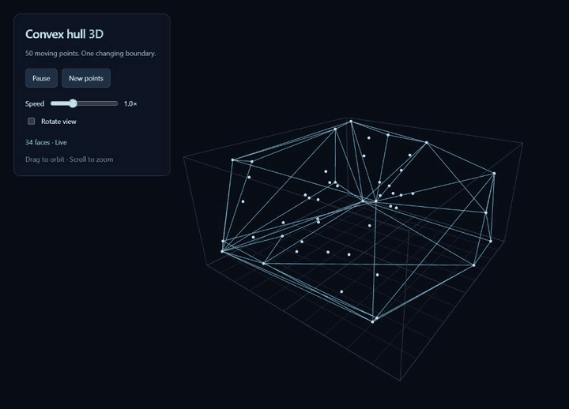

# ConvexHull3D

### Computational geometry, in motion.

**50 moving points. One constantly changing boundary.** Watch a cloud of points bounce through a three-dimensional box while their convex hull is recalculated at each animation update. Faces appear, disappear, and reconnect as the points exchange places on the boundary.

This project implements the randomized incremental 3D convex hull algorithm described in the book *[Computational Geometry: Algorithms and Applications](https://link.springer.com/book/10.1007/978-3-540-77974-2)*. See the [algorithm reference](#algorithm-reference) for the authors and relevant chapter.

**[Explore the live demo →](https://zlatmar.github.io/ConvexHull3D/)** · [How it works](#how-it-works) · [Run locally](#run-locally) · [Developer guide](docs/DEVELOPMENT.md)

[](https://github.com/zlatmar/ConvexHull3D/actions/workflows/ci.yml)
[](LICENSE)

[](https://zlatmar.github.io/ConvexHull3D/)

*A short loop captured from the running app. Click the animation to explore the live demo, or [view a still image](docs/images/convex-hull.png). No installation or account required.*

## A shape that discovers itself

Imagine stretching a perfectly taut skin around a collection of points. That enclosing shape is their **convex hull**: the smallest convex volume containing them all. Points inside the shape do not define its surface; the outermost points do.

Here, every point moves. An interior point can reach the boundary, an exposed point can retreat inside, and the enclosing surface must change with them. The animation makes these geometric transitions visible through a transparent wireframe you can inspect from any angle.

Try it in less than a minute:

- **Drag to orbit and scroll to zoom** into the geometry.
- **Pause** to study a configuration, then resume its evolution.
- **Change the speed** from 0.1× to 3× to follow individual transitions.
- **Generate new points** to explore another arrangement, or enable **Rotate view** for a continuous tour.

## More than a visualization

The project brings the book's algorithm into an interactive application. A TypeScript implementation computes the hull; Three.js brings the result to the screen.

| Engineering choice | What it delivers |
| --- | --- |
| **Randomized incremental hull construction** | Implements the book's algorithm, with simplex construction, face visibility, and horizon updates available to inspect in source. |
| **Doubly connected edge list (DCEL)** | Explicit relationships between vertices, edges, and faces, with checks for a closed, consistently connected surface. |
| **Adaptive orientation predicates** | Geometric decisions based on orientation signs, including collinear and coplanar cases. |
| **Separate geometry, simulation, and rendering** | A hull engine that can be exercised without a browser or Three.js scene. |
| **Reusable GPU buffers** | The display updates existing point and triangle buffers as the hull changes. |
| **Automated regression coverage** | Repeatable checks of geometry, topology, and motion alongside strict TypeScript compilation. |

## How it works

Each animation update advances the points, reflects them off the box walls, and constructs a fresh hull from their new positions. Within each construction, the algorithm grows the hull incrementally:

1. **Start with a tetrahedron.** Find four points that span three dimensions and orient its faces outward.
2. **Find the visible region.** Insert the remaining points in shuffled order. A bidirectional conflict graph tracks which faces each point can see; points already inside require no surface change.
3. **Trace the horizon.** Locate the boundary between visible and hidden faces, remove the visible region, and connect the horizon to the new point.
4. **Maintain the structure.** Update edge connections and conflicts, then expose the outward-facing triangles for rendering.

### Algorithm reference

**Mark de Berg, Otfried Cheong, Marc van Kreveld, and Mark Overmars.** *[Computational Geometry: Algorithms and Applications](https://link.springer.com/book/10.1007/978-3-540-77974-2)*. Third edition, Springer, 2008. DOI: [10.1007/978-3-540-77974-2](https://doi.org/10.1007/978-3-540-77974-2).

The central reference is **[Chapter 11: Convex Hulls — Mixing Things](https://link.springer.com/chapter/10.1007/978-3-540-77974-2_11)**, pp. 243–258. This project implements its randomized incremental approach to constructing a three-dimensional convex hull, including conflict tracking and horizon updates, and brings it to life through moving points and interactive rendering.

Orientation tests use [robust-predicates](https://github.com/mourner/robust-predicates), and the topology builds on the separate [DCEL library](https://github.com/zlatmar/DCEL).

Explore the implementation: [hull algorithm](src/classes/ConvexHull.ts) · [topology](src/ConvexDcel.ts) · [predicates](src/geometry/predicates.ts) · [particle simulation](src/simulation.ts) · [scene and controls](src/main.ts).

## Confidence, backed by checks

The [regression suite](tests/regression.mjs) exercises:

- **All 24 tetrahedron permutations**, plus cubes, integer grids, duplicate coordinates, and coplanar boundary points.
- **200 generated point clouds**, comparing hull volumes with the independent Three.js QuickHull implementation.
- **Translations, scaling, reflections, and nearly planar inputs**, with topology and containment checks.
- **1,000 animation frames** with 50 moving points, validating the rebuilt hull and particle bounds on every frame.
- **Motion at 30, 60, and 144 updates per second**, plus reflections that cross multiple walls in one step.

QuickHull is used for test comparisons. The live application uses the TypeScript implementation of the book's randomized incremental algorithm. Optional seeded randomness and diagnostic validation make geometric cases reproducible and easier to investigate.

The engine accepts full-dimensional 3D point sets and deduplicates identical coordinates. Collinear or wholly coplanar inputs produce explicit errors. See the [input contract and API example](docs/DEVELOPMENT.md#geometry-api) for supported coordinate ranges and validation options.

## Run locally

Use Node.js 22, the version used by CI, and clone with submodules:

```sh
git clone --recursive https://github.com/zlatmar/ConvexHull3D.git
cd ConvexHull3D
npm ci
npm run dev
```

Open the local URL printed by Vite.

| Command | Purpose |
| --- | --- |
| `npm test` | Run the geometry and simulation regression suite. |
| `npm run build` | Check TypeScript and create a production build. |
| `npm run preview` | Serve the production build locally. |

See the [developer guide](docs/DEVELOPMENT.md) for API usage, submodule setup, and GitHub Pages deployment.

## Built to be explored

Read the algorithm, pause the motion, test a difficult point set, or build on the geometry engine. ConvexHull3D is an invitation to see an abstract algorithm become a moving, inspectable object.

**[Open the live demo →](https://zlatmar.github.io/ConvexHull3D/)**

Released under the [MIT license](LICENSE).
